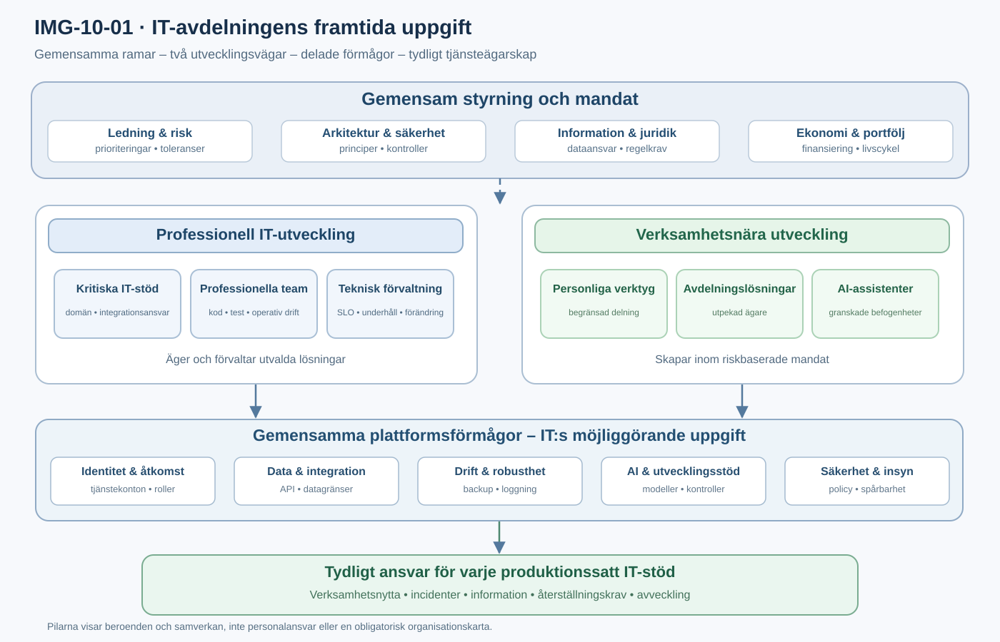

# 10. IT-avdelningens framtida uppgift

En verksamhet som själv kan bygga digitala arbetsflöden, applikationer och AI-assistenter kan vid första anblicken verka behöva mindre IT. Men om antalet digitala lösningar ökar samtidigt som fler människor får möjlighet att skapa dem blir en annan slutsats minst lika rimlig: organisationen behöver **mer gemensam digital förmåga, men mindre central handpåläggning i varje enskilt initiativ**.

Det innebär en förändring i IT-avdelningens uppgift, inte ett avskaffande av den. En del av IT behöver utvecklas till en möjliggörare som erbjuder teknik, tjänster och skyddsräcken som andra använder. En annan del behöver fortsätta att utveckla, drifta och förvalta sådana IT-stöd som kräver specialiserad kompetens, långsiktig kontinuitet eller höga krav på robusthet.

Kapitel 9 beskrev den möjliga teknikmiljön. Här är frågan i stället hur IT:s uppdrag avgränsas: **vad bör vara gemensamt, vad kan delegeras och vem ansvarar för resultaten?**

## Två uppgifter som behöver samexistera

I en traditionell organisation kan IT-avdelningens uppdrag beskrivas som att leverera och förvalta IT-stöd åt verksamheten. Ofta finns en intern beställare, ett systemägarskap och en driftsorganisation som får uppdrag att tillhandahålla det som behövs. Den modellen kommer att bestå för vissa typer av lösningar, men den kan inte ensam bära ett landskap där ett stort antal verksamhetsenheter bygger egna digitala tjänster.

Framtidens IT-avdelning behöver därför kunna utföra två olika uppgifter parallellt:

**Den möjliggörande uppgiften** är att tillhandahålla återanvändbara förmågor som gör det enkelt att bygga och använda digitala lösningar på ett säkert och kostnadseffektivt sätt. Hit hör identitets- och behörighetstjänster, integrationer, dataåtkomst, utvecklar- och AI-plattformar, standardiserad driftsättning, övervakning, incidenthantering och stöd till verksamhetsnära utvecklare.

**Den producerande och förvaltande uppgiften** är att fortsatt ansvara för utvalda IT-stöd som organisationen behöver hantera professionellt. Det kan gälla stora transaktionssystem, centrala register, tekniskt komplexa integrationer, kritiska informationsflöden eller verksamhetsstöd där driftstörningar har stora konsekvenser.

Dessa två uppgifter konkurrerar inte nödvändigtvis. Professionella utvecklingsteam kan använda samma gemensamma förmågor som verksamhetsnära utvecklare. Plattformar för identitet, loggning, integration och driftsättning kan göra båda kategorierna mer robusta. Men uppgifterna kräver delvis olika styrning, finansiering och kompetens. Ett team som bygger en kritisk tjänst behöver ansvar för den tjänstens hela livscykel; ett plattformsteam behöver ansvar för kvaliteten i en förmåga som många andra använder.

## Vad som behöver vara gemensamt

Det centrala misstaget vore att låta decentralisering betyda att varje del av verksamheten själv får lösa säkerhet, datatillgång, integrationsmönster och grundläggande drift. Det skulle ge lokala framsteg men också ökad sårbarhet och svåröverblickbara beroenden.

En användbar tumregel är att göra det gemensamt som **bör vara konsekvent för att skydda och hålla ihop organisationen**, eller som ger tydliga skalfördelar när det återanvänds. Däremot behöver lösningar som berör ett avgränsat verksamhetsproblem inte detaljstyras centralt om de håller sig inom gemensamma ramar.

Detta innebär exempelvis att IT kan ansvara för en gemensam identitets- och åtkomstmodell, medan verksamhetsansvarig bestämmer vilka roller som behöver åtkomst till en viss informationsmängd inom fastställda regler. IT kan erbjuda godkända API:er och integrationsplattformar, medan behörig informations- eller verksamhetsansvarig prövar ändamål och tillåten användning inom tillämpliga regler; personuppgiftsansvar och andra rättsliga skyldigheter kan inte delegeras bort genom en intern arbetsfördelning. IT kan tillhandahålla en säker publiceringsväg, medan den ansvariga verksamheten prioriterar när en ny funktion behövs.

Den tekniska plattformen ska alltså inte uppfatta sig som ägare till alla verksamhetsbeslut. Den ska göra det möjligt att genomföra legitima verksamhetsbeslut med rätt kontroll och spårbarhet. CNCF:s mognadsmodell för plattformsteknik understryker att plattformar behöver utformas som interna produkter, med användarbehov, livscykelhantering och återkoppling som centrala delar [K014].

## Ansvarskartan får flera nivåer

När fler skapar lösningar är det frestande att fråga vilken avdelning som ska "äga IT". Den frågan blir för grov. I stället behöver organisationen skilja mellan flera nivåer av ansvar.

På **organisationsnivå** behövs gemensamma principer för risk, informationssäkerhet, arkitektur, ekonomi, inköp och digital verksamhetsutveckling. Här beslutas vilka krav som alltid ska uppfyllas och vilka undantag som kräver särskild prövning.

På **förmågenivå** behöver någon äga plattformar och gemensamma tjänster. Det innebär att prioritera utveckling, finansiera livscykeln, ge användarstöd och ta ansvar för driften av förmågan även efter första lanseringen.

På **IT-stödsnivå** behöver någon ansvara för att den sammanhängande lösningen levererar sitt avsedda verksamhetsvärde. Detta ansvar omfattar krav, livscykel, beroenden, riskbedömning, tillgänglighetsbehov och beslut om avveckling. Det är inte samma sak som att själv drifta varje komponent.

På **komponentnivå** måste den som utvecklar eller tillhandahåller en tjänst ta ansvar för dess kod, konfiguration, tester, förändringar och operativa beteende enligt de gränssnitt som överenskommits.

När dessa nivåer hålls isär går det att ge team självständighet utan att skapa otydlighet kring helheten. En lokal lösning kan ägas av verksamheten, köras på en central plattform och använda data som förvaltas av en tredje part. Förutsättningen är att mandat, begränsningar och skyldigheter är dokumenterade och faktiskt kan följas.

I [@fig:IMG-10-01] visas en möjlig organisering. Den gemensamma styrningen ger ramar, men utförandet kan ske i professionella IT-team eller i verksamheten. Plattformen stödjer båda. En utsedd ansvarig behövs för varje produktionssatt IT-stöd, oavsett vem som skrev den första versionen av koden. Organisationsrutor och pilar ska läsas som ansvarsfunktioner och samarbeten, inte som en rekommendation om en viss organisationskarta.

## Hur IT:s olika delar förändras

### Arkitektur: från förhandsgranskning till förutsättningar

Arkitekturfunktionens uppgift förändras från att i stor utsträckning granska enskilda projektlösningar till att också utforma och förvalta gemensamma principer, tjänstekontrakt och godkända tekniska mönster. Den behöver hjälpa team att fatta bra beslut utan att själv fatta alla beslut.

Det kan innebära referensarkitekturer, rekommenderade integrationsmönster, krav på tjänsteidentitet, versionering av API:er och en tydlig hantering av undantag. För verksamhetsnära AI-lösningar tillkommer bland annat principer för modellval, datagränser och säkra verktygsanrop. Arkitekturens värde ligger inte i antalet godkännanden, utan i hur väl den möjliggör genomtänkta lokala beslut och begränsar oönskade helhetseffekter.

### Utveckling: från ensam producent till både producent och stöd

Professionella utvecklingsteam kommer fortfarande att behövas för komplexa system, svåra integrationer, avancerade datamodeller och säkerhetskritiska flöden. Men de kan också behöva stödja verksamhetsnära utvecklare med återanvändbara komponenter, teknisk rådgivning, kodgranskning och hjälp att lyfta en lovande prototyp till en robust tjänst.

Det skapar ett nytt samspel: verksamheten kan utforska behov och bygga tidiga lösningar, medan professionell utveckling kopplas in när risk, komplexitet eller livslängd motiverar det. Tröskeln mellan dessa lägen måste vara tydlig. Om det saknas en väg från prototyp till förvaltad produkt kan lösningar bli verksamhetskritiska utan att någon har planerat deras livscykel. Vägen behöver omfatta en namngiven ägare, säkerhets- och dataprövning, återställningskrav, operativt stöd och beslut om fortsatt finansiering.

### Drift och plattform: från beställningsmottagare till tjänsteleverantör

Driftsorganisationens kompetens blir inte mindre viktig. Den behövs fortfarande för kapacitet, nätverk, databaser, redundans, säkerhetskopiering, återställning, övervakning och krisberedskap. Men stora delar av denna kompetens behöver paketeras som standardiserade förmågor som andra kan använda med så lite manuell handpåläggning som möjligt.

Här ligger en betydande organisatorisk utmaning. Ett plattformsteam kan inte bara bygga automatisering och sedan övergå till nästa projekt. Det behöver också driva, supportera, vidareutveckla, övervaka och avveckla sina plattformstjänster. En bra plattform är en långlivad intern produkt, inte en tillfällig teknisk installation [K014].

### Säkerhet och regelefterlevnad: från grindvakt till inbyggda kontroller

Säkerhetsfunktionen behöver fortsatt formulera krav, bedöma risker, följa upp kontroller och pröva avvikelser. Men allt fler kontroller bör genomföras automatiskt i de standardvägar som används. Exempel är policykontroll vid driftsättning, behörighetsstyrning, spårbar loggning och begränsningar för vilka AI-modeller eller externa tjänster som får användas.

Det betyder inte att riskbedömning blir automatisk. Godkända tekniska byggblock kan inte på egen hand avgöra om en viss användning av personuppgifter är lämplig, eller om en AI-assistent bör få fatta ett visst beslut. Sådana avvägningar kräver ansvariga personer och ibland formellt beslutsmandat. NIST:s AI Risk Management Framework betonar styrning, uppföljning och tydligt ansvar för AI-risker över livscykeln [K006], [K019].

### Förvaltning: från systemlista till levande portfölj

Förvaltning behöver få bättre överblick över vilka digitala lösningar som faktiskt används, vem som ansvarar för dem och vilka gemensamma förmågor de är beroende av. Detta gäller även lösningar som har skapats utanför traditionella IT-projekt.

En långsiktigt hållbar modell kräver därför någon form av registrering och livscykelhantering: ägare, syfte, dataklassning, beroenden, kostnader, teknisk kontakt, kritikalitet, uppföljning och avvecklingsplan. Den behöver vara proportionerlig. En personlig assistent som inte delas med andra kräver inte samma administration som ett verksamhetskritiskt ärendehanteringssystem.

## Ledningens uppgift: välja gränser och investeringar

Om IT:s roll förändras utan att ledningens syn på styrning och finansiering förändras riskerar förflyttningen att stanna halvvägs. Plattformsteam förväntas då leverera nya förmågor samtidigt som deras budget och framgångsmått fortfarande utgår från antalet beställningar eller tekniska installationer. Verksamheten får möjlighet att skapa lösningar men saknar mandat för informationsanvändning, införande eller livscykelbeslut.

Ledningen behöver därför besluta om tre saker.

För det första: **vilka beslut måste vara gemensamma?** Det omfattar exempelvis övergripande riskacceptans, säkerhetskrav, informationsklassning, ekonomiska ramar och strategiskt viktiga tekniska standarder.

För det andra: **vilka beslut kan fattas där nyttan uppstår?** Det kan handla om lokal prioritering, utformning av ett arbetsflöde, val av godkända byggblock och viss publicering inom bestämda riskgränser.

För det tredje: **vem ansvarar för att de gemensamma förmågorna fungerar över tid?** Här behövs ett uttryckligt produkt- och tjänsteägarskap med finansiering för vidareutveckling, stöd, säkerhet och drift. DORA:s forskning från 2025 beskriver AI som en förstärkare av organisationens befintliga styrkor och svagheter; kvaliteten i plattformar, arbetssätt och samordning är därför central för att AI ska skapa långsiktig nytta [K005].

Det är viktigt att se detta som ledningsbeslut, inte bara teknikbeslut. En intern plattform utan finansiering och tydliga ägare blir förr eller senare en ny flaskhals. Verksamhetsnära utveckling utan avgränsade mandat kan bli ett nytt skuggsystemlandskap.

## Vad som kan och inte kan delegeras

En hållbar delegering skiljer mellan **att få utföra en handling**, **att ansvara för resultatet** och **att få acceptera risken**. De tre behöver inte ligga på samma person eller grupp.

Verksamheten kan till exempel få skapa en ny assistent med godkända verktyg, och den kan ansvara för att assistenten löser ett lokalt problem. Men den får inte därmed automatiskt godkänna obegränsad åtkomst till känsliga data eller ändra organisationens säkerhetskrav. Behöriga informations- och riskansvariga beslutsfunktioner måste fortfarande kunna styra användningen, och eventuell riskacceptans måste ske inom de mandat som faktiskt har beslutats. Tekniskt genomförande ger inte i sig rätt att acceptera informations- eller säkerhetsrisker.

På samma sätt kan utvecklingsteam få driftsätta egna tjänster på en intern plattform utan att få rätt att kringgå grundläggande policykontroller. Plattformen möjliggör självständigt genomförande inom definierade gränser. Det är inte samma sak som att det gemensamma ansvaret upphör.

## Tre sätt som förflyttningen kan misslyckas

**Allt blir en central IT-fråga igen.** Om samtliga verksamhetslösningar fortfarande kräver samma manuella processer som traditionella projekt försvinner mycket av möjligheten till snabb, lokal utveckling. IT-avdelningen blir då en flaskhals trots nya verktyg.

**Allt decentraliseras utan stöd.** Om varje verksamhetsdel själv måste lösa identitet, dataåtkomst, versionshantering, säkerhetskopiering och teknisk support kommer variationen och riskerna att öka. Det kan ge tillfällig snabbhet men svag långsiktighet.

**Ingen vill äga den färdiga lösningen.** Det tredje misslyckandet är särskilt vanligt i övergången från prototyp till produktion. En lösning kan vara uppskattad och användas brett, men ändå sakna ansvar för behörigheter, incidenter, underhåll och avveckling. Det spelar då liten roll om den ursprungligen skapades av en IT-utvecklare eller av verksamheten.

Det som förenar de tre problemen är att tekniska möjligheter inte automatiskt skapar fungerande ansvarsfördelning.

## Hur en större organisation kan börja

En fullständig omorganisation är sällan ett bra första steg. Det är bättre att pröva den nya modellen i ett begränsat område där det finns tydlig verksamhetsnytta och möjligheter att lära.

Ett sådant försök kan till exempel utgå från ärendehanteringsstödet som följt boken. Verksamheten får bygga en intern assistent som hjälper handläggare att hitta relevant information och sammanställa underlag. Assistenten använder godkända API:er och identiteter. Plattformsteamet ansvarar för driftsmiljö, loggning och tekniska skydd. Informationsägare beslutar om åtkomst och användning. Verksamheten ansvarar för kvaliteten i arbetsflödet och för att resultatet granskas av människor där det behövs. Ett utpekat IT-stödsägarskap säkerställer att beroenden, incidenter och avveckling kan hanteras om lösningen blir viktig för den dagliga verksamheten.

Detta exempel visar att verksamhetsnära utveckling inte måste innebära att IT lämnas utanför. IT:s bidrag flyttar snarare till de delar där gemensam kompetens verkligen ger skalfördelar.

För att avgöra om modellen fungerar bör organisationen följa både **förmåga att leverera** och **förmåga att hålla lösningarna säkra och fungerande**. Exempel på relevanta frågor är: Har ledtiden minskat? Behöver utvecklaren färre manuella kontakter? Kan ansvarig identifieras när ett fel uppstår? Fungerar återställning och loggning? Har nya beroenden eller kostnader blivit tydliga? Har verksamheten fått ett snabbare sätt att testa idéer utan att skapa fler okända produktionssystem?

## När en större förflyttning bör vänta

Det är för tidigt att skala upp verksamhetsdriven utveckling om organisationen ännu inte kan erbjuda tillräckligt säkra integrationsvägar, hantera behörigheter eller registrera vilka lösningar som finns. Detsamma gäller om det saknas ansvariga för datakvalitet och informationsanvändning, eller om man inte har en fungerande modell för att överta och förvalta lösningar som växer i betydelse.

Det betyder inte att experiment måste stoppas. Personliga eller avgränsade försök inom låga risknivåer kan vara mycket värdefulla. Men ambitionen bör då vara att utveckla gemensamma förmågor och ansvar i takt med användningen, inte att omedelbart göra alla verksamhetsenheter självförsörjande på IT.

## Centrala fakta

- IT-avdelningens roll kan samtidigt vara **möjliggörare av andras utveckling** och **professionell leverantör av utvalda kritiska IT-stöd**.
- Gemensamma tekniska förmågor ska standardisera det som behöver hållas ihop, inte detaljstyra varje lokal verksamhetslösning.
- Komponentägarskap, plattformsägarskap, informationsansvar och ansvar för hela IT-stödet måste gå att skilja åt.
- Delegering av utveckling och driftsättning är inte detsamma som delegering av riskacceptans eller informationstillstånd.
- Plattformar behöver finansieras och förvaltas som långlivade interna produkter, inte som engångsprojekt [K014].

## Nästa perspektiv

De fyra generationerna beskriver olika sätt att lösa problem, inte fyra nivåer som alla måste passera. Nästa och avslutande kapitel använder därför bokens insikter för att hjälpa läsaren avgöra vad som bör bevaras, vad som behöver förenklas och när en större förflyttning faktiskt är motiverad.
